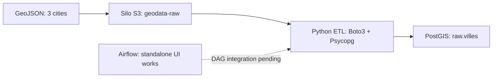

# Homelab — Infrastructure & Data Platform Engineering

Self-hosted, single-node data and platform engineering laboratory on a GMKtec M8 running Ubuntu Server 26.04.1 LTS.

The aim is to learn Linux/Platform Engineering and implement reproducible geospatial pipelines, gradually expanding from Docker Compose to Kubernetes, streaming and a lakehouse.

> **Status: 2026-11-18.** This repository documents validated terminal sessions and contains reviewed **reference examples**. The live Docker Compose files and Python scripts were created on `homelab-01` and have **not been synchronized automatically** to this repository. The examples may differ from their exact on-host versions.

## Current capabilities

| Layer | Implementation | Evidence / status |
|---|---|---|
| Host | GMKtec M8, Ubuntu Server 26.04.1, NVMe/LVM | Operational |
| Networking | Netplan Ethernet, hardened SSH keys, Tailscale | Validated remote access |
| Firewall | UFW rule preparation and recovery plan | **UFW inactive**; activation deferred until local console access |
| Configuration management | Ansible Core 2.18.7 on Mac, SSH inventory, read-only system audit | **7 ok, 0 changed, 0 failed, 1 skipped** |
| Container runtime | Docker Engine 29.10.0, Compose v5.8.0 | `hello-world` passed |
| Spatial database | PostgreSQL 17 / PostGIS 3.7 in Docker | `PostGIS_Version()` and SQL spatial queries passed |
| S3-compatible object store | PGSTY Silo release 2026-11-09 in Docker | Health HTTP 200; bucket and object write/read validated |
| Python ETL | Python 3.14 virtualenv, Boto3, Psycopg 3 | S3 GeoJSON → `raw.villes`; two runs, 3 rows |
| Workflow orchestration | Airflow 3.3.1, standalone in Docker | Web login works; **demo DAG not yet discovered** (`airflow dags list`: `No data found`) |
| Lakehouse/streaming/orchestration | Spark, Kafka, dbt, Trino, Iceberg, K3s, Helm, GitOps | Planned, not deployed |
| Cloud / other databases | Oracle, AWS RDS, Snowflake | Integration targets, not installed locally |

## Validated pipeline

- S3 bucket: `geodata-raw`; object key: `villes/villes.geojson` (623 bytes).
- Spatial data: Paris, Lille and Dakar, EPSG:4326.
- The Python ETL uses `ON CONFLICT (nom, pays) DO UPDATE`; both observed executions ended with 3 rows, without duplicates.
- Database exposed only on Ubuntu loopback port 5433; S3 API/console on loopback ports 9000/9001; Airflow Web on loopback port 8080. Browser access uses an SSH tunnel.
- **Do not confuse persistence with backup:** named Docker volumes are not backups.

## Architecture and runbooks

- [Architecture and deployed services](diagrams/architecture.md)
- [Host installation](docs/01-installation.md)
- [Networking](docs/02-networking.md)
- [SSH and Tailscale](docs/03-ssh.md)
- [Ansible audit and sudo compatibility](docs/04-ansible.md)
- [Docker and PostGIS](docs/05-docker-postgis.md)
- [S3 storage and Python ETL](docs/06-s3-etl.md)
- [Airflow deployment and current DAG blocker](docs/07-airflow.md)
- [Roadmap and operational risks](docs/08-roadmap.md)
- [Reference examples](examples/README.md) — **review and adapt** before deploying; not auto-synced from the server

## Operational and security notes

- Do **not** commit `.env`, credentials, SSH keys, Airflow auth files, database volumes, user data or server backups. See `.gitignore`.
- An Airflow admin password was exposed in chat during setup; **rotate it before additional use**. The rotation has not been confirmed.
- Ansible `sudo-rs` elevation on this Ubuntu version timed out; selecting `/usr/bin/sudo.ws` per host in inventory worked.
- The host has reported a pending reboot/update; schedule it with a tested access/recovery path.
- All configuration runs are presently on a single physical host with no redundancy.
