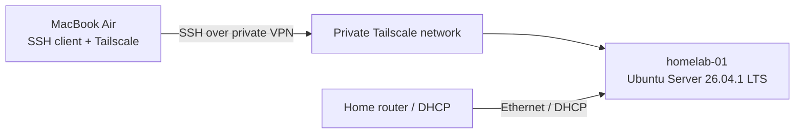

# Homelab — Infrastructure & Data Platform Engineering

Self-hosted infrastructure on dedicated hardware, developed as an operational foundation for infrastructure automation, container orchestration, observability and data engineering workloads.

The current deployment is a **single-node Ubuntu Server environment**. Its initial baseline covers host provisioning, network readiness, SSH hardening and private remote administration. Subsequent iterations will introduce configuration management and platform services, with deployed capabilities kept distinct from planned work.

## Infrastructure at a glance

| Layer | Implementation | State |
|---|---|---|
| Compute | GMKtec M8 mini-PC | Deployed |
| Operating system | Ubuntu Server 26.04.1 LTS | Deployed |
| Storage | NVMe SSD with LVM | Deployed |
| LAN | Wired Ethernet (`enp2s0`), DHCP, Netplan/systemd-networkd | Validated |
| Administration | OpenSSH with Ed25519 public-key authentication | Validated |
| SSH access policy | Password and keyboard-interactive authentication disabled; direct root login disabled | Validated |
| Private remote access | Tailscale on Ubuntu Server and macOS | Validated from an external network |
| Configuration management | Ansible | Planned |
| Container runtime / orchestration | Docker, Kubernetes (k3s evaluation) | Planned |
| Observability | Prometheus, Grafana and centralized logs | Planned |
| Data services | PostgreSQL, MinIO, Airflow and related workloads | Planned |

**Deployment scope:** one physical server; no high-availability or multi-node guarantees.

## Architecture

Remote administration uses a private Tailscale address and the same hardened OpenSSH service used for LAN access. No router-level public SSH port forwarding was configured as part of this deployment. SSH authentication remains based on the workstation's Ed25519 key; the private key is not deployed to the server.

See [architecture details](diagrams/architecture.md). The detailed architecture document is being updated to reflect the VPN deployment.

## Implemented baseline

### Host and network

- Installed Ubuntu Server on dedicated hardware using UEFI boot and LVM-backed storage.
- Configured the wired interface through Netplan with DHCP.
- Investigated a failed `systemd-networkd-wait-online.service` unit caused by the disconnected secondary Ethernet interface. Marked that interface optional, verified network readiness checks and confirmed no failed systemd units after reboot.
- Applied operating-system package updates and validated the running kernel after reboot.

### Administrative access

- Generated a dedicated Ed25519 SSH key pair on macOS and installed only the public key on the server.
- Applied OpenSSH hardening through `/etc/ssh/sshd_config.d/00-homelab-hardening.conf`, ahead of the cloud-init drop-in.
- Verified effective settings with `sshd -T` and configuration syntax with `sshd -t`.
- Confirmed successful key-based login and rejection of password-only authentication.
- Enrolled the server and MacBook in the same Tailscale network; validated SSH access from an external network.
- Configured a local SSH alias (`ssh homelab`) and macOS Keychain integration for the client identity.

These checks validate the stated configuration and connectivity; they do not constitute a complete security assessment.

## Engineering decisions and constraints

| Decision | Rationale / constraint |
|---|---|
| Dedicated physical host | Enables direct control over Linux, networking, storage and host operations |
| SSH key authentication | Removes password-based remote login while retaining a tested administrative path |
| Separate OpenSSH drop-in | Keeps local hardening distinct from cloud-init-managed configuration; effective precedence is verified |
| Tailscale for remote access | Provides private connectivity without configuring inbound SSH port forwarding on the home router |
| Incremental platform deployment | Establishes a tested host baseline before introducing automation and application workloads |

**Outstanding controls:** firewall policy has not yet been documented as validated; a stable DHCP reservation, backup/restore procedures, monitoring and automated configuration remain to be implemented or verified. Remote access depends on the host, network and Tailscale service being available.

## Delivery roadmap

- [x] Provision Ubuntu Server on physical hardware with LVM
- [x] Validate Ethernet connectivity and resolve network readiness failure
- [x] Apply OS updates and verify post-reboot service health
- [x] Deploy and validate SSH public-key authentication and hardening
- [x] Establish and test remote administration over Tailscale
- [ ] Review firewall rules and administrative network exposure
- [ ] Configure and verify stable LAN addressing
- [ ] Automate baseline configuration with Ansible
- [ ] Define and test backup and recovery procedures
- [ ] Deploy containerized workloads and evaluate k3s
- [ ] Introduce metrics, logs and alerting
- [ ] Deploy data platform services and an end-to-end pipeline

## Documentation

- [Host provisioning and storage](docs/01-installation.md)
- [Network configuration](docs/02-networking.md)
- [SSH administration](docs/03-ssh.md)
- [Architecture](diagrams/architecture.md)

**Documentation status:** the linked technical notes were written during initial provisioning and are being revised to reflect the validated SSH and Tailscale baseline.

## Repository scope

This repository tracks architecture, selected configuration examples, validation procedures and operational decisions. It is not a backup of the server or a credential store. Configuration examples will be reviewed for sensitive values before publication.
