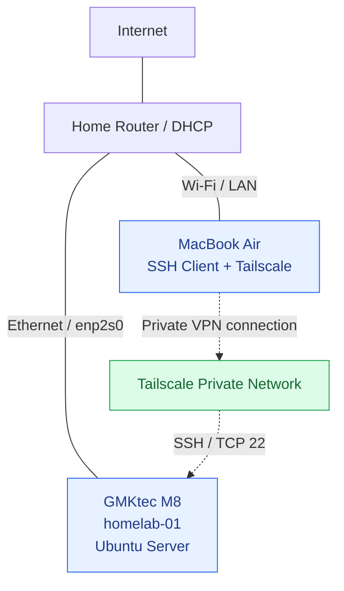

# Homelab Architecture

## Current architecture — Phase 1

## Infrastructure inventory

| Component | Role | Status |
|---|---|---|
| MacBook Air | Administration workstation | Active |
| GMKtec M8 | Physical Ubuntu Server host | Active |
| Home router | LAN connectivity and DHCP | Active |
| OpenSSH | Secure remote administration | Active |
| Tailscale | Private remote connectivity | Active |
| Ansible | Configuration management | Planned |
| Docker / Kubernetes | Container infrastructure | Planned |
| Prometheus / Grafana | Monitoring and observability | Planned |

## Network information

- Hostname: `homelab-01`
- Active interface: `enp2s0`
- LAN address observed: `192.168.1.12/24`
- Address assignment: DHCP
- Tailscale address observed: `100.80.166.89`
- Remote administration: SSH on TCP port 22

## Architecture decisions

1. Use dedicated physical hardware for server workloads.
2. Administer the server remotely from macOS.
3. Use SSH public-key authentication with a dedicated Ed25519 key.
4. Disable SSH password authentication and direct root login.
5. Use Tailscale for private remote connectivity.
6. Introduce infrastructure automation incrementally.

## Future evolution

The infrastructure will evolve toward automated provisioning,
container orchestration, observability and a self-hosted data platform.

The current deployment consists of one physical server.
High availability and distributed workloads are not yet implemented.
