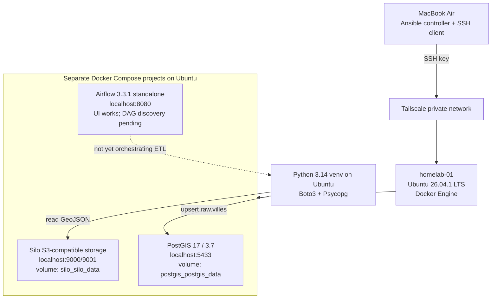
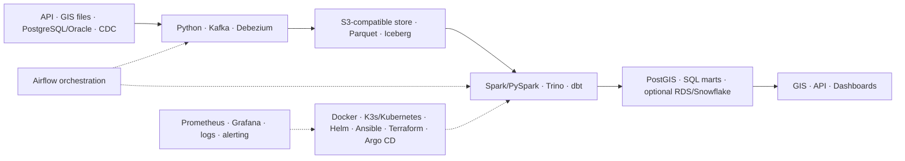

# Homelab architecture — deployed and target

**Snapshot: 2026-11-18.** The current environment runs on **one GMKtec M8 host**. This is a laboratory platform, not an HA cluster.

## Deployed topology

The Docker Compose projects have separate default networks. The tested ETL currently runs directly on Ubuntu, using services' loopback-bound host ports. **The Airflow container cannot reach those services via its own `127.0.0.1`.** Shared Docker networking and least-privilege credentials remain a prerequisite for orchestration.

## Data layers

- **Source:** manually produced 623-byte GeoJSON with three Point features.
- **Object store:** `geodata-raw/villes/villes.geojson` on Silo.
- **ETL:** manual Python extract/validate/upsert.
- **Serving:** PostgreSQL/PostGIS table `raw.villes` with Paris, Lille and Dakar.
- **Orchestration:** Airflow UI reachable over Mac-to-Ubuntu SSH tunnel; DAG parsing/registration not yet validated.

## Infrastructure and access

- Ethernet interface `enp2s0` with observed DHCP LAN address `192.168.1.12/24`, gateway `192.168.1.254`.
- Private SSH via Tailscale, observed server address `100.80.166.89`.
- SSH public-key auth only; direct root SSH and SSH password authentication disabled.
- UFW rules staged but firewall **inactive**; only activate with physical console/recovery.
- Docker-published PostGIS, S3 and Airflow endpoints bound to `127.0.0.1` of Ubuntu. Expose Web UI to Mac using SSH port forwarding, not public ports.
- Named volumes persist through container restarts, but no backups or HA have been validated.

## Target architecture (not deployed)

The target is phased to suit the current ~11.9 GiB usable RAM and single-node storage. Kafka, Spark, Iceberg, dbt, Trino, Kubernetes, Oracle, RDS and Snowflake are **planned, not installed or validated**.

## Documentation

- [Host installation](../docs/01-installation.md)
- [Networking](../docs/02-networking.md)
- [SSH](../docs/03-ssh.md)
- [Ansible](../docs/04-ansible.md)
- [Docker and PostGIS](../docs/05-docker-postgis.md)
- [S3 ETL](../docs/06-s3-etl.md)
- [Airflow](../docs/07-airflow.md)
- [Roadmap](../docs/08-roadmap.md)
