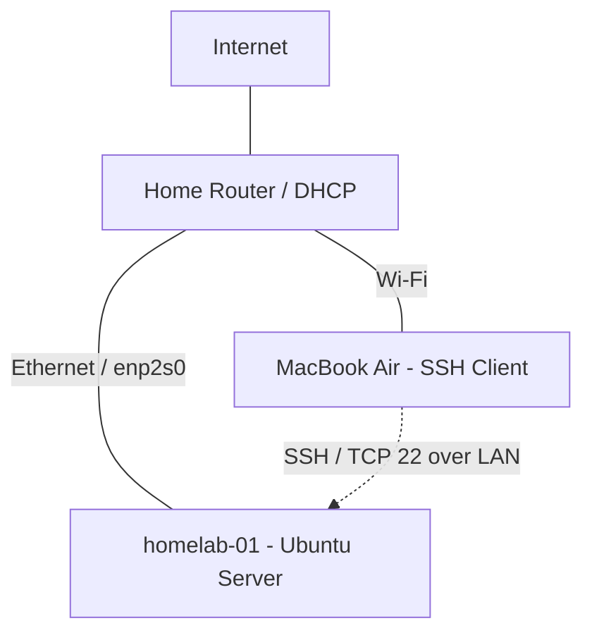

# Homelab Architecture

## Current architecture — Phase 1

## Infrastructure inventory

| Component | Role | Status |
|---|---|---|
| MacBook Air | Administration workstation | Active |
| Home router | LAN connectivity and DHCP | Active |
| GMKtec | Ubuntu Server node | Active |
| OpenSSH | Remote administration | Working |
| VPN | Secure external access | Planned |
| Docker / Kubernetes | Container infrastructure | Planned |

## Network information

- Hostname: `homelab-01`
- Active interface: `enp2s0`
- Current LAN address: `192.168.1.12/24`
- Address assignment: DHCP
- Remote administration: SSH on TCP port 22

## Architecture decisions

1. Use dedicated physical hardware for server workloads.
2. Administer the server remotely from macOS.
3. Keep SSH access within the local network initially.
4. Introduce SSH keys and firewall hardening before remote access.
5. Introduce infrastructure automation incrementally.

## Future evolution

The architecture will evolve toward container orchestration,
infrastructure automation, monitoring and a self-hosted data platform.
