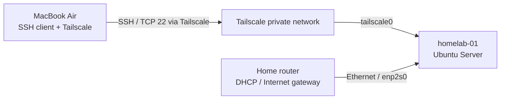

# Network Architecture & Connectivity

## Scope

This document describes the networking baseline of `homelab-01`: physical connectivity, DHCP addressing, Netplan/systemd-networkd behavior, network readiness troubleshooting, and private remote administration through Tailscale.

The deployment uses a single physical Ubuntu Server host connected to a home router. It is **not** a redundant network design.

## 1. Topology and traffic paths



The server is reachable on the local network via its DHCP-assigned address and remotely through its Tailscale address. The SSH service is shared across these paths; the VPN does not replace SSH authentication.

| Parameter | Observed value | Notes |
|---|---|---|
| Hostname | `homelab-01` | Ubuntu Server 26.04.1 LTS |
| Active wired interface | `enp2s0` | Connected to home router |
| LAN IPv4 | `192.168.1.12` | DHCP-assigned; subject to lease changes |
| LAN subnet | `192.168.1.0/24` | Observed local addressing |
| Tailscale IPv4 | `100.80.166.89` | Private tailnet endpoint |
| Administration client | MacBook Air | Tailscale peer `100.104.23.26` at validation time |
| Remote administration | OpenSSH / TCP 22 | Ed25519 public-key authentication |

These addresses are recorded as an observed baseline, not guaranteed permanent assignments.

## 2. Interface management

Ubuntu Server uses Netplan with `systemd-networkd` as the network backend. The active physical uplink is `enp2s0`; the second Ethernet interface is not connected.

Useful inspection commands:

```bash
ip -br addr
ip route
networkctl list
sudo netplan get
```

The server was installed with DHCP on the wired interface. A router-side DHCP reservation has **not** been verified. Default gateway and DNS resolver details should be captured separately from the live host rather than inferred from the subnet.

## 3. Incident: network readiness unit failed at boot

### Symptom

Following initial provisioning, `systemd-networkd-wait-online.service` was reported as failed. The active Ethernet interface was functional, but a disconnected secondary interface affected the network readiness check.

### Root cause and remediation

The network readiness check was waiting on a disconnected Ethernet interface (`eno1` in the affected configuration). This interface was not required for the host's primary network path.

The Netplan configuration was adjusted to mark the unused interface as optional:

```yaml
# Relevant setting only; not a complete copy of the host's Netplan file.
ethernets:
  eno1:
    optional: true
```

This prevents the unused interface from being treated as a boot-time network readiness dependency. It does not bring the interface up, disable it, or change the active uplink.

**Operational caution:** interface names must be verified on the target host before applying this setting. Earlier inventory notes listed a secondary Ethernet interface as `enp1s0`; the incident configuration referred to `eno1`. The authoritative mapping and full Netplan file should be captured during the next host configuration audit.

### Validation

After applying the configuration and rebooting, the host was reachable and `systemctl --failed` reported zero failed units.

For repeatable checks:

```bash
sudo netplan get
systemctl status systemd-networkd-wait-online.service --no-pager
systemctl --failed
ip -br addr
```

The observed post-reboot result establishes that the failure was cleared in that test; longer-term boot reliability has not yet been measured.

## 4. Remote access through Tailscale

Tailscale is installed on both the Ubuntu host and the macOS administration workstation. The server-side `tailscaled` service was observed active, and both devices were connected to the same tailnet.

The administrative path was validated from a network outside the home LAN:

```bash
ssh -i ~/.ssh/id_ed25519_homelab mouhamadou@100.80.166.89
```

The Mac also uses a local SSH alias:

```bash
ssh homelab
```

The alias resolves to the Tailscale address and selects the dedicated client identity. Its macOS configuration includes `IdentitiesOnly yes`, `AddKeysToAgent yes` and `UseKeychain yes`.

**Security boundary:** Tailscale provides private network reachability; OpenSSH independently enforces key-based authentication. Password and keyboard-interactive SSH authentication, as well as direct root login, were disabled and the effective SSH configuration was checked. No public SSH port forwarding was configured on the router as part of this setup.

Tailscale connectivity alone does not establish a complete firewall policy or a review of tailnet ACL/grants. Those remain separate tasks.

## 5. Operational diagnostics

| Check | Command | Purpose |
|---|---|---|
| Interface addresses | `ip -br addr` | Verify physical and VPN addresses |
| Routes | `ip route` | Inspect default and local routes |
| Resolver | `resolvectl status` | Inspect configured DNS |
| Networkd | `networkctl status enp2s0` | Check active uplink state |
| Netplan | `sudo netplan get` | Inspect merged declarative network configuration |
| Boot failures | `systemctl --failed` | Identify failed units |
| Tailscale daemon | `systemctl is-active tailscaled` | Confirm service activity |
| Tailnet peers | `tailscale status` | Inspect peer connectivity |
| SSH effective policy | `sudo sshd -T` | Verify server authentication settings |

For changes affecting the only remote access path, retain a recoverable session or local console access and validate the configuration before rebooting.

## 6. Validated outcomes and open work

**Validated**
- Wired LAN connectivity and DHCP assignment on `enp2s0`.
- Initial package mirror connectivity.
- Local SSH access.
- Resolution of the network readiness failure after Netplan adjustment and reboot.
- Active Tailscale service and remote SSH login from outside the home LAN.
- SSH key-based login and rejection of password-only authentication.

**Pending verification or implementation**
- Capture the complete interface mapping and canonical Netplan configuration.
- Verify default route, DNS servers and router DHCP lease/reservation.
- Review firewall rules and exposed listening services on LAN and VPN interfaces.
- Review Tailscale access policies and device authorization.
- Define monitoring for link, VPN and SSH availability.
- Establish operational recovery procedures for loss of remote connectivity.

## Related documentation

- [Host provisioning](01-installation.md)
- [SSH administration](03-ssh.md)
- [Infrastructure architecture](../diagrams/architecture.md)

The linked documents are being updated incrementally to reflect this baseline.
