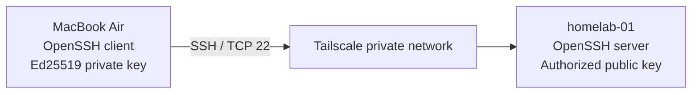

# SSH Administration & Access Hardening

## Scope

This document describes the administrative SSH baseline for `homelab-01`, an Ubuntu Server 26.04.1 LTS host managed from macOS. It covers key-based authentication, server-side OpenSSH policy, client configuration, connectivity over Tailscale, and the checks used to validate the deployment.

The SSH service runs on the Ubuntu host; Tailscale provides an additional private network path, not a replacement authentication mechanism.

## 1. Access model



| Control | Implemented state |
|---|---|
| SSH transport | OpenSSH, TCP 22 |
| Administrative account | `mouhamadou` |
| Client authentication | Dedicated Ed25519 key pair |
| Public key placement | Server account's `~/.ssh/authorized_keys` |
| Private key placement | macOS workstation only |
| Password authentication | Disabled |
| Keyboard-interactive authentication | Disabled |
| Direct root SSH login | Disabled |
| Remote connectivity | Tailscale, validated outside the home LAN |
| macOS client convenience | SSH alias, SSH agent, Keychain integration |

The private key is passphrase-protected. The key fingerprint displayed by `ssh-add -l` identifies the **client key** and must not be confused with the server's SSH host key fingerprint.

## 2. Server-side hardening

The administrative SSH policy is maintained in a dedicated configuration drop-in:

```text
/etc/ssh/sshd_config.d/00-homelab-hardening.conf
```

Relevant settings:

```sshconfig
PubkeyAuthentication yes
PasswordAuthentication no
KbdInteractiveAuthentication no
PermitRootLogin no
```

A separate cloud-init drop-in (`50-cloud-init.conf`) contained `PasswordAuthentication yes` during provisioning. OpenSSH configuration processing makes include ordering relevant: the local hardening file was named to precede the cloud-init file, and the **effective** configuration was checked rather than inferred from the file contents alone.

Configuration checks performed on the server:

```bash
sudo sshd -t
sudo sshd -T
systemctl is-active ssh
```

The syntax check succeeded, the service was active, and effective settings were inspected to confirm the intended authentication policy.

### SSH socket activation and listening addresses

The SSH listening configuration was inspected on 2026-11-10.

Ubuntu uses systemd socket activation for SSH on this host. The `ssh.socket` unit is enabled and defines the following listening endpoints:

```ini
ListenStream=0.0.0.0:22
ListenStream=[::]:22
BindIPv6Only=ipv6-only
```

The effective OpenSSH configuration was independently checked with `sudo sshd -T`. It confirmed listening on all IPv4 and IPv6 addresses, with public-key authentication enabled, password authentication disabled, keyboard-interactive authentication disabled, and direct root login disabled.

Commands used during validation:

```bash
systemctl is-enabled ssh.socket
systemctl cat ssh.socket
sudo sshd -T
sudo ss -tulpen
```

Because systemd manages the listening sockets, changes to SSH listening addresses must account for `ssh.socket` as well as `sshd_config`.

Listening on all interfaces does not prove public Internet reachability. The host firewall, router configuration and upstream network filtering must be considered separately.

**Change safety:** retain an existing working session and confirm a new public-key login before disabling password-based access or reloading SSH. An out-of-band recovery path should be available for future policy changes.

## 3. Client identity and configuration

The macOS workstation uses a dedicated key:

```text
~/.ssh/id_ed25519_homelab
~/.ssh/id_ed25519_homelab.pub
```

The public key is authorized on `homelab-01`; the private key stays on the workstation.

The macOS SSH configuration uses the following host alias:

```sshconfig
Host homelab
    HostName 100.80.166.89
    User mouhamadou
    IdentityFile ~/.ssh/id_ed25519_homelab
    IdentitiesOnly yes
    AddKeysToAgent yes
    UseKeychain yes
```

The SSH config file is restricted with `chmod 600 ~/.ssh/config`. The client identity can be registered with the macOS agent and Keychain:

```bash
ssh-add --apple-use-keychain ~/.ssh/id_ed25519_homelab
ssh-add -l
```

The agent reported the dedicated Ed25519 identity as loaded, and `ssh homelab` successfully opened a session without another passphrase prompt during the tested session. Persistence after a fresh macOS login has not been separately verified.

## 4. Remote access validation

The host is connected to the private Tailscale network and has been reached from outside the home LAN.

Direct connection using the dedicated client identity:

```bash
ssh -i ~/.ssh/id_ed25519_homelab mouhamadou@100.80.166.89
```

Equivalent connection through the configured alias:

```bash
ssh homelab
```

Both methods were validated. The resulting shell identified the target as `mouhamadou@homelab-01` running Ubuntu Server 26.04.1 LTS.

Password-only authentication was explicitly tested and rejected with `Permission denied (publickey)`. Public-key login continued to work after the hardening change.

### Host authenticity

On first connection to a previously unknown SSH endpoint, OpenSSH prompts for the server's **host key** fingerprint and stores the accepted key in `known_hosts`.

The recorded first-use prompt for the Tailscale endpoint displayed this Ed25519 host key fingerprint:

```text
SHA256:GLKeqd/+OECgKVyRNGs1ypDjSSATFLdrnvxpg3yfCGY
```

The fingerprint was accepted during setup; independent out-of-band verification was not documented. For subsequent provisioning, compare the presented fingerprint with a trusted value obtained from the server console before accepting it. A changed host key must be investigated rather than automatically trusted.

## 5. Troubleshooting record

### Incorrect execution context

An SSH command was executed from an Ubuntu shell while referencing the private key path that exists on the Mac. The identity file was unavailable and authentication failed with `Permission denied (publickey)`.

**Resolution:** distinguish the local macOS prompt from the remote Ubuntu prompt; run client SSH commands from the workstation. Do not copy the private key to the server to work around this error.

### Missing SSH alias

`ssh homelab` initially failed with a hostname resolution error because `~/.ssh/config` did not exist on macOS.

**Resolution:** create the SSH config with the `Host homelab` stanza, restrict file permissions, and retest. The alias then connected successfully.

### Initial transient connection interruption

An early LAN SSH attempt terminated with `Broken pipe`. The subsequent attempt succeeded without a documented configuration change. The root cause remains undetermined; this event should not be attributed to a specific network or SSH fault without evidence.

## 6. Operational verification

| Verification | Command / method | Result |
|---|---|---|
| Server config syntax | `sudo sshd -t` | Passed |
| Effective SSH policy | `sudo sshd -T` | Intended settings confirmed |
| SSH service state | `systemctl is-active ssh` | Active |
| Key-based login | `ssh homelab` from macOS | Successful |
| Password-only login | Explicit password-only SSH test | Rejected |
| Remote VPN path | SSH via Tailscale from external network | Successful |
| Client agent | `ssh-add -l` | Dedicated Ed25519 identity loaded |

| SSH socket activation | `systemctl is-enabled ssh.socket` | Enabled |
| SSH socket configuration | `systemctl cat ssh.socket` | IPv4 and IPv6 port 22 listeners confirmed |
| Listening sockets | `sudo ss -tulpen` | SSH listening on all IPv4 and IPv6 interfaces |
## 7. Security boundaries and outstanding work

The implemented controls restrict SSH authentication, but do not establish comprehensive host security.

Remaining work includes:

- Design and validate an explicit inbound firewall policy for SSH, preserving Tailscale access and a trusted LAN recovery path. The 2026-11-10 audit found UFW inactive, Tailscale-managed nftables rules, and no general default-deny inbound policy.
- Review Tailscale device authorization and access policies.
- Establish a documented administrative recovery procedure.
- Evaluate SSH access logging and alerting.
- Verify host key fingerprints against a trusted source.
- Confirm macOS Keychain behavior across fresh login sessions.
- Introduce repeatable SSH configuration management with Ansible.

## Related documentation

- [Network architecture and Tailscale](02-networking.md)
- [Host provisioning](01-installation.md)
- [Infrastructure architecture](../diagrams/architecture.md)
